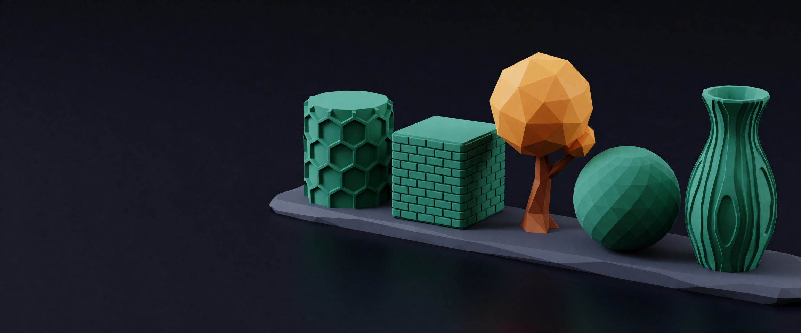
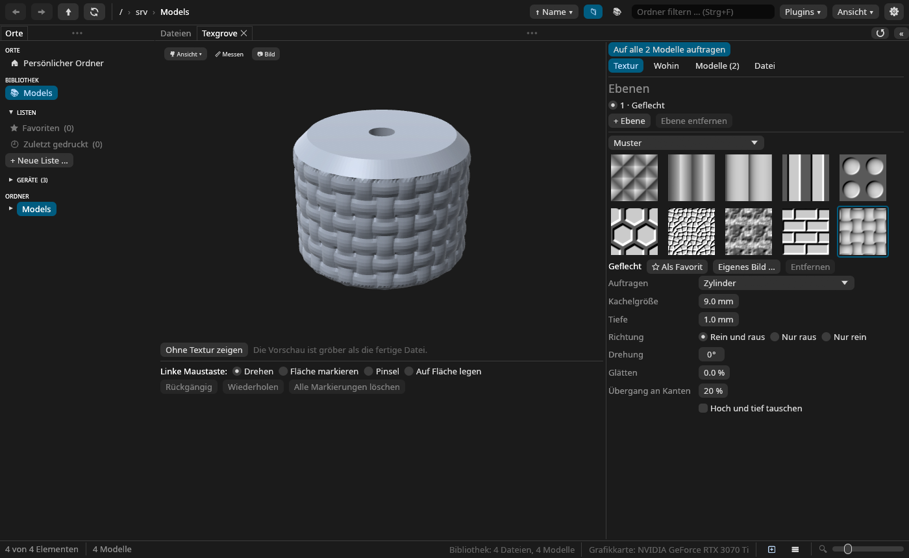

<p align="center"></p>

# Texgrove

**Texturen als echte Geometrie für 3D-Drucke.** Texgrove bringt Rändel, Waben, Geflecht, Holz,
Leder und eigene Bilder als Relief auf ein Modell, so wie der Drucker es druckt, und legt das
Ergebnis als neue Datei neben das Original. Es ist ein Plugin für
[Meshgrove](https://github.com/DonDavis-vibe/MeshGrove), daneben gibt es eine Kommandozeile,
und auch eine KI wie Claude kann es bedienen.

*English version: [README.md](README.md)*

## Was es kann

- **Texturen:** zehn Muster aus Formeln (Rändel, Rillen, Rippen, Streifen, Noppen, Waben,
  Zellen, Rauschen, Ziegel, Geflecht), zwölf Natur- und Materialbilder, 32 Hero Patterns und
  jedes eigene PNG oder JPEG (hell ist hoch).
- **Aufgetragen** rundum, wie eine Box, um einen Zylinder, entlang des Umrisses, um eine Kugel,
  flach von einer Seite oder einmal als Stempel per Klick. Alle Maße sind Millimeter.
- **Dorthin, wo du willst:** überall, nur außen (Bohrungen und Hohlräume behalten ihr Maß), nur
  innen; die Unterseite bleibt glatt, damit das Teil plan aufliegt. Von Hand: Fläche anklicken,
  Pinsel, Rückgängig.
- **Ebenen:** bis zu vier Texturen auf einem Modell, die sich verdecken oder addieren.
- **Dateien, die der Slicer mag:** Das Netz wird nur dort verfeinert, wo Textur hinkommt, auf
  ein Dreiecksbudget reduziert und bleibt geschlossen. Ein 3MF-Projekt behält seine anderen
  Objekte, Platten und Einstellungen.

## Installieren

Texgrove braucht Meshgrove **0.9.1 oder neuer**.

1. `texgrove.wasm` und `texgrove.wasm.sha256` aus den
   [Releases](https://github.com/DonDavis-vibe/Texgrove/releases) laden und prüfen:
   ```bash
   sha256sum -c texgrove.wasm.sha256
   ```
2. In Meshgrove *Einstellungen → Plugins* öffnen und die Datei mit „Durchsuchen …“ wählen (oder
   sie vorher nach `~/.local/share/meshgrove/plugins/` kopieren, unter Windows nach
   `%APPDATA%\meshgrove\plugins`).
3. Texgrove installieren und „Dateien in die Bibliothek legen“ erlauben. Soll eine KI es nutzen:
   auch „Werkzeuge für die KI“ und „Bibliothek lesen“ – ohne das Lesen sieht Texgrove nur, was
   du selbst öffnest.

## Benutzen

Ein oder mehrere Modelle in Meshgroves Galerie mit rechts anklicken und **Textur auftragen …**
wählen, oder den gleichnamigen Knopf im Info-Bereich drücken. Das Panel zeigt eine grobe
Vorschau; Textur wählen, Kachelgröße und Tiefe einstellen, sagen, wohin sie soll, und **Textur
auftragen** drücken. Die neue Datei liegt neben dem Original, mit dem Tag „Texturiert“ und
allen Einstellungen in der Notiz; im Reiter *Datei* lässt sie sich gleich auf eine Druckliste
setzen. Rückgängig geht über Meshgroves Verlauf.



## Mit einer KI

| Werkzeug | Was es tut |
|---|---|
| `texgrove_textures` | listet die Texturen, mit nummeriertem Bild |
| `texgrove_inspect` | Größe, Teile, Innen-Anteil eines Modells, sinnvolle Kachelgrößen und Tiefen |
| `texgrove_preview` | ein Bild des Modells vorher und nachher |
| `texgrove_apply` | erzeugt die texturierte Datei im Hintergrund; sie wartet in Meshgroves Prüfung |

## Kommandozeile

```bash
cargo run --release -p texgrove-cli -- apply modell.stl -o raendel.3mf \
    --texture knurl --tile 6 --depth 0.8 --mapping cylindrical --where outside --picture bild.png
```

`texgrove pattern` listet die eingebauten Muster, `texgrove diag modell.stl` sagt, ob ein Netz
geschlossen ist.

## Entwicklung

```
crates/texgrove-core     der Kern: Netze, Texturen, Projektionen, Masken, verfeinern, verschieben, reduzieren
crates/texgrove-cli      der Befehl `texgrove`
crates/texgrove-plugin   das Meshgrove-Plugin (wasm32-wasip2, eigener Workspace)
scripts/check.sh         Format, Clippy, Tests und der Plugin-Build
scripts/build.sh         target/plugin/texgrove.wasm
scripts/build-textures.py  erzeugt assets/textures aus heruntergeladenen Quellen
assets/                  Icon, Banner und die mitgelieferten Texturen
tasks/todo.md            die Etappen und ihr Stand
```

`texgrove-core` ist reines Rust ohne Plattform darunter; andere Plugins dürfen es benutzen.

## Dank

Die Idee stammt von [BumpMesh](https://bumpmesh.com) von Stefan Hermann (CNC Kitchen), das
dasselbe im Browser macht. Texgrove ist von Grund auf in Rust geschrieben und übernimmt weder
Code noch Texturen daraus.

Mitgelieferte Texturen: Höhenbilder von [Poly Haven](https://polyhaven.com) (CC0) und Muster
von [Hero Patterns](https://heropatterns.com) von Steve Schoger
([CC BY 4.0](https://creativecommons.org/licenses/by/4.0/)); die Liste steht in
[assets/textures/CREDITS.md](assets/textures/CREDITS.md).

## Lizenz

MIT oder Apache-2.0, nach Wahl. © 2026 Davis ([German Redneck Engineering](https://redneck-design.de/)).
