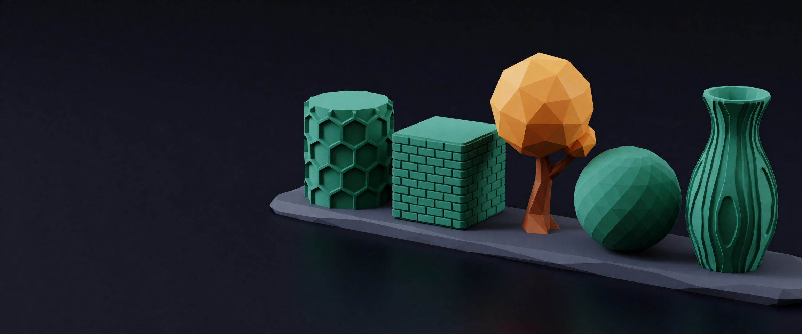
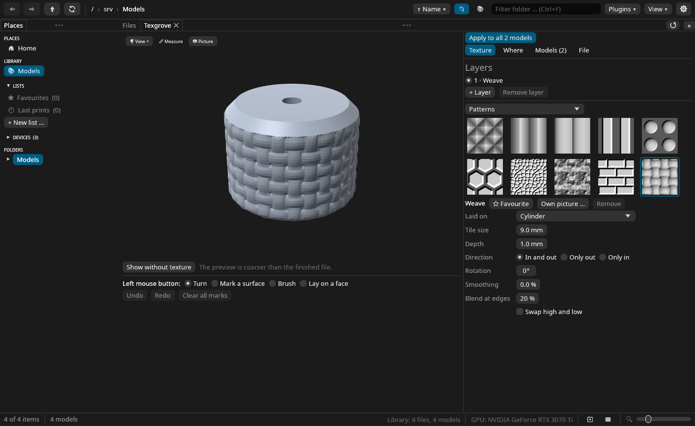

<p align="center"></p>

# Texgrove

**Textures as real geometry for 3D prints.** Texgrove puts knurls, hexagons, weaves, wood,
leather and your own pictures onto a model, as relief a printer prints, and saves the result as
a new file beside the original. It is a plugin for
[Meshgrove](https://github.com/DonDavis-vibe/MeshGrove), with a command line beside it, and an
AI such as Claude can use it too.

*Deutsche Fassung: [README.de.md](README.de.md)*

## What it does

- **Textures:** ten patterns made by formulas (knurl, grooves, ribs, stripes, dots, hexagons,
  cells, noise, bricks, weave), twelve nature and material maps, 32 Hero Patterns, and any PNG
  or JPEG of your own (bright is high).
- **Laid on** from all round, like a box, round a cylinder, along the part's outline, round a
  sphere, flat from one side, or once as a stamp where you click. Sizes are millimetres.
- **Where you want it:** everywhere, outside only (bores and hollows keep their size), inside
  only; the bottom stays smooth so the part lies flat. By hand: click a surface, brush, undo.
- **Layers:** up to four textures on one model, covering or adding to each other.
- **Files a slicer likes:** the mesh is refined only where the texture goes, reduced to a
  triangle budget, and stays closed. A 3MF project keeps its other objects, plates and settings.

## Install

Texgrove needs Meshgrove **0.9.1 or newer**.

1. Download `texgrove.wasm` and `texgrove.wasm.sha256` from the
   [releases](https://github.com/DonDavis-vibe/Texgrove/releases) and check the download:
   ```bash
   sha256sum -c texgrove.wasm.sha256
   ```
2. In Meshgrove open *Settings → Plugins* and choose the file with "Browse …" (or copy it to
   `~/.local/share/meshgrove/plugins/` first, on Windows `%APPDATA%\meshgrove\plugins`).
3. Install Texgrove and grant "Put files into the library". For an AI to use it, also grant
   "Tools for the AI" and "Read the library": without reading, Texgrove sees only what you open
   yourself.

## Using it

Right-click one or several models in Meshgrove's gallery and choose **Apply texture …**, or
press the button of that name in the Info pane. The panel shows a coarse preview; pick a
texture, set tile size and depth, say where it goes, and press **Apply texture**. The new file
lands beside the original, tagged "Textured", with every setting in its note. Undo is in
Meshgrove's history.



## With an AI

| Tool | What it does |
|---|---|
| `texgrove_textures` | lists the textures, with a numbered picture |
| `texgrove_inspect` | size, parts, how much of a model is inside, sensible tile sizes and depths |
| `texgrove_preview` | a picture of a model before and after |
| `texgrove_apply` | makes the textured file in the background; it waits in Meshgrove's review |

## Command line

```bash
cargo run --release -p texgrove-cli -- apply model.stl -o knurled.3mf \
    --texture knurl --tile 6 --depth 0.8 --mapping cylindrical --where outside --picture look.png
```

`texgrove pattern` lists the built-in patterns, `texgrove diag model.stl` says whether a mesh
is closed.

## Development

```
crates/texgrove-core     the kernel: meshes, textures, projections, masks, refine, move, reduce
crates/texgrove-cli      the `texgrove` command
crates/texgrove-plugin   the Meshgrove plugin (wasm32-wasip2, its own workspace)
scripts/check.sh         format, clippy, tests, and the plugin build
scripts/build.sh         target/plugin/texgrove.wasm
scripts/build-textures.py  makes assets/textures from downloaded sources
assets/                  icon, banner and the textures that ship
tasks/todo.md            the milestones and where they stand
```

`texgrove-core` is plain Rust without a platform underneath; other plugins may use it.

## Credits

The idea comes from [BumpMesh](https://bumpmesh.com) by Stefan Hermann (CNC Kitchen), which does
this in the browser. Texgrove is written from scratch in Rust and takes no code or textures
from it.

Textures that ship with Texgrove: displacement maps from [Poly Haven](https://polyhaven.com)
(CC0) and patterns from [Hero Patterns](https://heropatterns.com) by Steve Schoger
([CC BY 4.0](https://creativecommons.org/licenses/by/4.0/)); the list is in
[assets/textures/CREDITS.md](assets/textures/CREDITS.md).

## License

MIT or Apache-2.0, at your choice. © 2026 Davis ([German Redneck Engineering](https://redneck-design.de/)).
